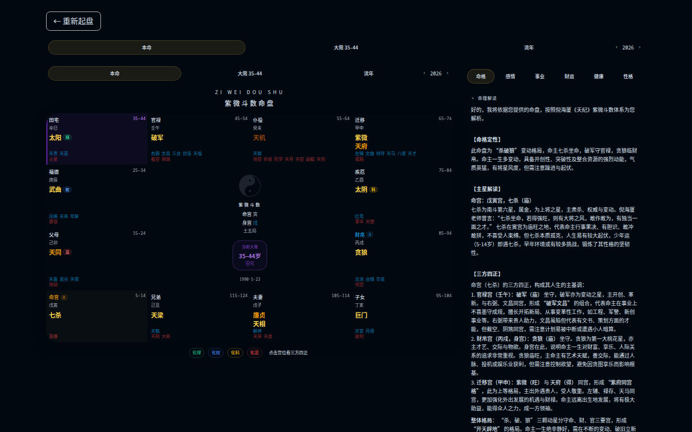
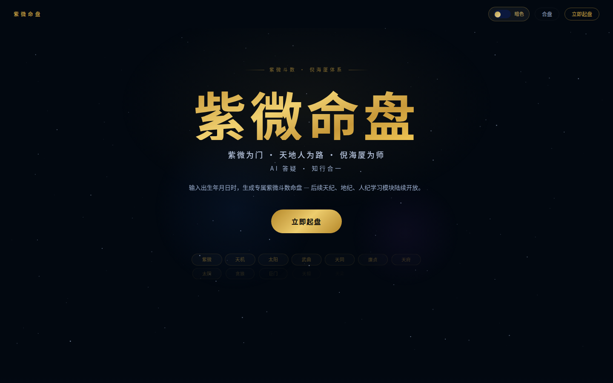
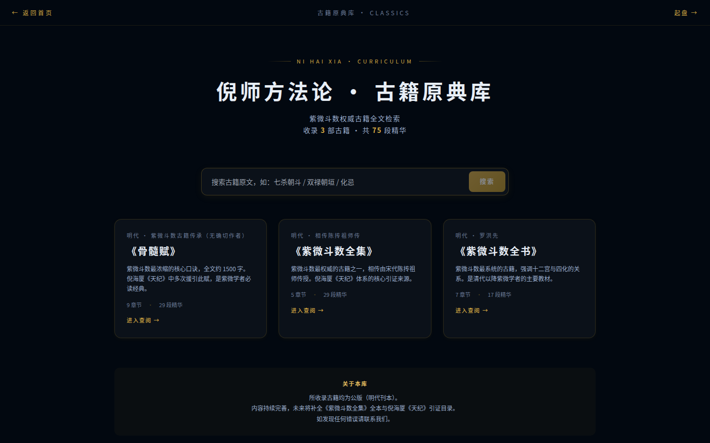

# Deploy and Host Zi Wei Dou Shu (紫微斗数) on Railway

Your own Zi Wei Dou Shu (紫微斗数, Purple Star Astrology) site: enter a birth date and time and get a full twelve-palace chart, with AI readings in the Ni Haixia (倪海厦《天纪》) tradition from the model of your choice. It's built on the open-source charting engine [Renhuai123/ziwei-doushu](https://github.com/Renhuai123/ziwei-doushu) (MIT, 12k+ stars). The interface is in Chinese.

## Screenshots

## About Hosting Zi Wei Dou Shu

One small service, with no database and no volume. Charts are computed in the visitor's browser by the open-source engine. It handles true solar time by birthplace longitude, China's 1986–1991 daylight saving, leap months and the late Zi hour (晚子时), as well as the Four Transformations (四化) for the natal chart, the decade (大限) and the year (流年), and 1,100+ pattern rules. The service serves the pages and, when you add a key, the AI readings.

- **Chart (排盘)**: twelve palaces with star brightness, transformations and self-transformations, and switching between the natal chart, the decade and the year.
- **AI readings (命理解读)**: the reading panel and follow-up chat for life themes, relationships, career, wealth and health.
- **Compatibility (合盘)**: two charts read together.
- **Classics library (古籍原典库)**: 《骨髓赋》, 《紫微斗数全集》 and 《紫微斗数全书》, with full-text search.
- **Star encyclopedia (命理百科)**: the 14 major stars in each of the 12 palaces.

## Common Use Cases

- A personal or family Zi Wei Dou Shu tool, private and free of ads.
- A practitioner's site where clients view their own chart and readings.
- A base for building your own astrology product on an MIT-licensed engine.

## Dependencies for Zi Wei Dou Shu Hosting

- None for charts.
- For AI readings, an API key from any OpenAI-compatible provider: DeepSeek (the default), OpenAI, OpenRouter, a self-hosted model and so on.

### Deployment Dependencies

- [Charting engine on GitHub](https://github.com/Renhuai123/ziwei-doushu)
- [DeepSeek API keys](https://platform.deepseek.com/api_keys)
- [Template source](https://github.com/two-workspaces/ziwei-doushu)

### Implementation Details

**AI readings.** The open-source repo ships the engine and interface but not the AI backend. This template adds the two routes the interface calls (`/api/interpret` and `/api/heming`). They pass the chart and the question to the model you configure and stream the answer back. Set these variables on the service:

| Variable | Default | |
|---|---|---|
| `AI_API_KEY` | empty | Your provider key. While it's empty, charts work and the reading panel says the AI isn't configured. |
| `AI_BASE_URL` | `https://api.deepseek.com` | Any OpenAI-compatible base URL, e.g. `https://api.openai.com/v1` or `https://openrouter.ai/api/v1`. |
| `AI_MODEL` | `deepseek-flash` | The model name at that provider. |
| `AI_REQUESTS_PER_HOUR` | `30` | AI requests allowed per visitor IP per hour, so a public site can't drain your key. Set `0` to turn the limit off. |

**Your domain.** Canonical links, the sitemap and social previews use the Railway domain automatically. After you add a custom domain, set `SITE_URL=https://your.domain` and redeploy.

**Resources.** The service idles at about 100 MB of RAM, which fits the Free plan.

**Upstream.** The engine is pinned to an upstream commit and updated deliberately. The upstream's hosted site has a larger judgment library (断语库) and its own AI prompts that aren't open source, so readings here come from your model and the chart. They are not the upstream's paid readings.

## Why Deploy Zi Wei Dou Shu on Railway?

Railway is a singular platform to deploy your infrastructure stack. Railway will host your infrastructure so you don't have to deal with configuration, while allowing you to vertically and horizontally scale it.

By deploying Zi Wei Dou Shu on Railway, you are one step closer to supporting a complete full-stack application with minimal burden. Host your servers, databases, AI agents, and more on Railway.
